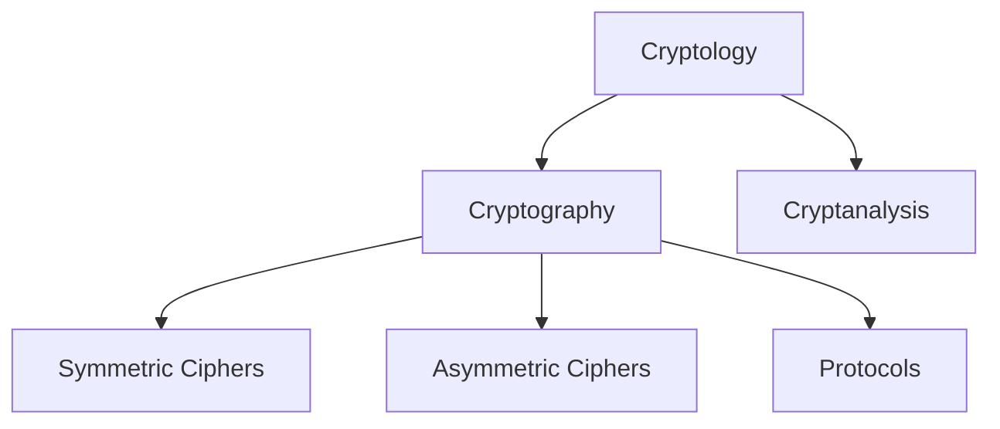
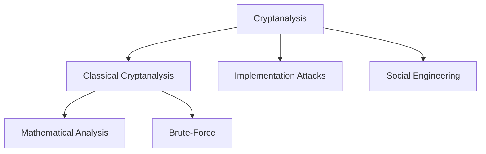

# Understanding Cryptography by Christof Paar

- Cryptography -> science of secret writing w/ the goal of hiding the meaning of the message
- Cryptanalysis -> science of breaking cryptosystems
- Symmetric Algorithms -> two parties have encryption and decryption functions in which they both share a secret key
    - All cryptography since until 1976 is based on symmetric algorithms
    - Widely used today for data encryption and integrity checks
- Asymmetric (Public-Key) Algorithms -> a user possesses the secret key as well as the public key
    - Introduced by Whitfield Diffie, Martin Hellman, and Ralph Merkle in 1976
    - Used for digital signatures, key establishment, and data encryption
- Protocols -> the application of cryptographic algorithms
    - Ex: TLS
- Hash functions share properties with symmetric algorithms
- Hybrid Schemes -> the use of multiple different cryptographic algorithms in a system

## Symmetric Cipher
- Known as symmetric cryptographic schemes *aka* symmetric-key *aka* secret-key *aka* single-key schemes/algorithms 
- Problem:
    - Two users Alice & Bob want to communicate over an insecure channel w/o anyone else listening no it
        - Channel -> a communication link
    - Bad guy Oscar is listening (eavesdropping) to the insecure channel
- Solution:
    - Symmetric cipher can be used where:
        - Alice -> x -> Encrypt(x, k) -> y -> Insecure Channel
        - Insecure Channel -> Bob -> y -> Decrypt(y, k) -> x
        - Insecure Channel -> Oscar -> y
        - Oscar only "hears" random characters
        - Both parties (Alice and Bob) needs to know the k (key)
            - In this system, there needs to be a secure channel to distribute the key (textbook will get into it later)
    - x -> plaintext/cleartext
    - y -> ciphertext
    - k -> key
    - Set of all possible keys is known as the key space
- > Both encryption & decryption functions should be publicly known as through peer review can the functions be strong
- > The only thing that should be secret is the key
- **The problem of transmitting a message securely is simply the the problem of transmitting and storing the key securely**

- The Substitution/Replacement Cipher:
    - Idea: substitue each letter of the alphabet with another one
    - Key: substitution table
    1. Attack - Brute-Force / Exhaustive Key Search
        - Testing all possible keys
        - Can result in false-positives
        - Is always possible against symmetric ciphers in principle
        - Is considered computationally secure if it takes too long
        - In this attack, we don't consider the structure of the cipher at all
    2. Attack - Letter Frequency Analysis
        - > The Substitution Cipher can easily be broken by an analytical attack as it maps the statistical properties of the plaintext into the ciphertext
        - Determine the frequency of each character & try to map that into the average frequency and structure
        - Note: a large key space doesn't matter in this attack
    - **Good ciphers hide statistical properties of the ciphertext to where is should appear random; large keyspace != strong encryption**

## Cryptanalysis

- Classical Cryptanalysis -> science of recovering plaintext x or key k from ciphertext y
- Implementation Attacks -> side-channel analysis to obtain the secret key
    - Measuring what happens to where the cryptographic algorithm is *implemented*
    - Most revelant when the attacker has physical access
- Social Engineering Attacks -> tricking humans to obtain the secret key
- (Attacks vary and are plenty)

- Kerckoffs' Principle -> a cryptosystem should be secure even if the attacker knows the algorithm (on a personal level :p) with exception to the key

## Modular Arithmetic
- A simple way of performing arithmetic in a finite set of integer
- Ex) A clock: 24hrs; we'll say something about the next x hours, but we never leave the set
- Consider the set of nine numbers: {0,1,2,3,4,5,6,7,8}
    - Regular arithmetic is acceptable as long as it's smaller than 9
        - 2\*3=6
        - 4+4=8
    - If the number were bigger than nine then we divide it by 9 and consider only the remainder
        - 8+4=12 -> 12/9 -> 1R3 -> 3
            - $8+4\equiv{3\mod9}$
- Definition: Modulo Operation
    - Let a, r, $m\in{Z}$, and m > 0
        - $a\equiv{r\mod{m}}$
        - m: modulus
        - r: remainder
        - Z: set of all integers
    - If m divides (a-r)
- Computation of the Remainder
    - Always possible to write $a\in{Z}$ in which:
        - $a=q*m+r$ for 0 <= r < m
        - Because $a-r=q*m$ (m divides (a-r)) -> $a\equiv{r\mod{m}}$
            - Note: $r\in{\{0,1,2,...,m-1\}}$
    - Ex) a=42, m=9
        - $42=4*9+6$
        - $42\equiv{6\mod{9}}$
- **The Remainder Is Not Unique**: given modulus m and number a, there are an infinite amount of valid remainders
    - Ex) Reduce 12 modulo 9
        - $12\equiv{3\mod{9}}$ -> 9|(12-3)
        - $12\equiv{21\mod{9}}$ -> 9|(12-21)
        - $12\equiv{-6\mod{9}}$ -> 9|(12-(-6))
        - "x|y": "x divides y"
        - The set of numbers ({...,-15,-6,3,12,15,...})formed is known as a *equivalence class*
            - For modulus 9, there are 8 other equivalence classes:
                - {...,-27,-18,-9,0,9,18,27,...}
                - {...,-26,-17,-8,1,10,19,28,...}
                - ...
                - {...,-19,-10,-1,8,17,26,35,...}
- **All Members of an Equivalence Class Behave Equivalently**
    - > For modulus m, it matters not which element from the class is chosen for a computation
    - The core operation of many practical public-key schemes is an exponentiation of the form $x^e\mod{m}$ in which x,e, & mare often very big numbers (we'll say 2048bits)
        - There are two ways of doing modular exponentiation (say we want to compute $3^8\mod{7}$)
            1. Straightfoward: $3^8=6561=2\mod{7}$ since $6561=937*7+2$
            2. Smarter:
                1. Perform partial exponentiation ($3^8 = 3^4 * 3^4 = 81 * 81$)
                2. Replace (81) by another member of the same equiv. class (4)
                3. $3^8=81*81\equiv{4*4=16\mod{7}}$ -> $16\equiv{2\mod{7}}$
                - **It is always a computational advantage to apply the modulo reduction whenever possible in order to keep the number small** 
                - Which remainder/member do we choose?
                    - By agreement: 0 <= r <= (m-1)
                    - Mathmatically: doesn't matter

- Integer Rings
    - The integer ring $Z_m$ consists of:
        1. The set $Z_m=\{0,1,2,...,m-1\}$
        2. Two operations: "+" & "*" for all $a,b\in{Z}$ such that:
            1. $a+b\equiv{c\mod{m}}$, ($c\in{Z_m}$)
            2. $a*b\equiv{d\mod{m}}$, (${d\in{Z_m}}$)
    - Ex) m = 9
        - Set: $Z_9=\{0,1,2,3,4,5,6,7,8\}$
        - $6+8=14\equiv{5\mod{9}]$
        - $6*8=48\equiv{3\mod{9}}$
    - Properties:
        - We can add or multiply any two numbers and the result will always be within the ring. Ring is said to be closed
        - Addition and multiplication are associative (order doesn't matter)
        - In addition there exists a nuetral element 0 ($a+0\equiv{a\mod{m}}$)
        - For any element a in the ring there exists a negative element (additive inverse always exists) ($a+-a\equiv{0\mod{m}}$)
        - In multiplication there exists nuetral element 1 ($a*1\equiv{a\mod{m}}$)
        - **For some**, the multiplication inverse exists
            - Let $a\in{Z}$, inverse $a^-1$ such that:
                - $a*a^-1\equiv{1\mod{m}}$
            - If the inverse exists for a, we can divide this element as $b/a\equiv{b*a^-1\mod{m}}$
            - It takes a fair bit of effort to find the inverse (often utilizing the Euclidean Formula), but fortunately there is an easy way of telling whether a number has an inverse:
                - Element $a\in{Z}$ has a multiplicative inverse $a^-1$ **if and only if** gcd(a, m) = 1 (gcd: greatest common denominator), then a and m are relatively prime or coprime
                - Ex) $Z_26$
                    - gcd(15, 26)=1 thus the inverse exists
                    - gcd(14, 26)=2 thus the inverse doesn't exist
        - Distributive law still holds: $a*(b+c)=(a*b)+(a*c)$ for all $a,b,c\in{Z}$
## Historical Ciphers
- Shift/Caesar Cipher
    - Idea: shift every letter by a fixed number of positions in the alphabet
    - Definition: Shift Cipher
        - Let $x,y,k\in{Z_26}$
        - **Encryption**: $e_k(x)\equiv{x+k\mod{26}}$
        - **Decryption**: $d_k{y}\equiv{y-k\mod{26}}$
    - Ex) k = 17
        - Plaintext: ATTACK = 0,19,19,0,2,10
        - Ciphertext: 17,10,10,17,19,1 = rkkrtb
    - Two ways of attacking:
        1. Small keyspace means bruteforce is viable
        2. Letter frequency analysis
- Affine Cipher
    - Idea: multiply the plaintext by one part of the key then addition by another part of the key
    - Definition: Affine Cipher
        - Let $x,y,a,b\in{Z_26}$
        - **Encryption**: $e_k{x}=y\equiv{a*x+b\mod{26}}$
        - **Decryption**: $d_k{y}=x\equiv{a^-1*(y-b)\mod{26}}$
        - k = (a,b), restriction: gcd(a, 26) = 1
    - Reminder: restriction exists because the inverse cannot exist unless gcd(a, 26) = 1
    - Ex) key=(9, 13)
        - Plaintext: ATTACK = 0,19,19,0,2,10
        - Ciphertext: 13,2,2,13,5,25 = nccnfz
    - Attacking:
        1. Keyspace is only slightly bigger than Shift thus bruteforce is still viable
        2. Letter frequency analysis
