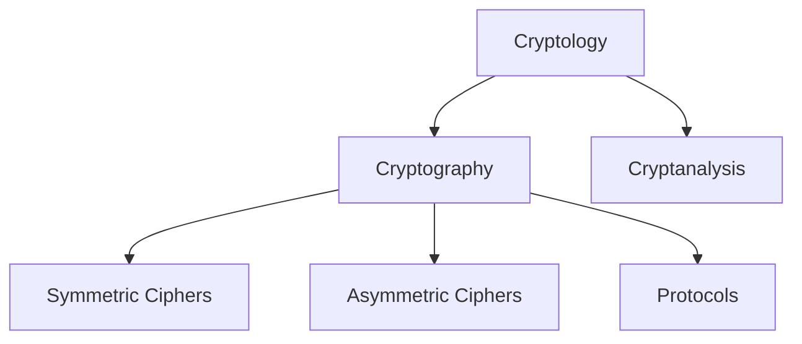
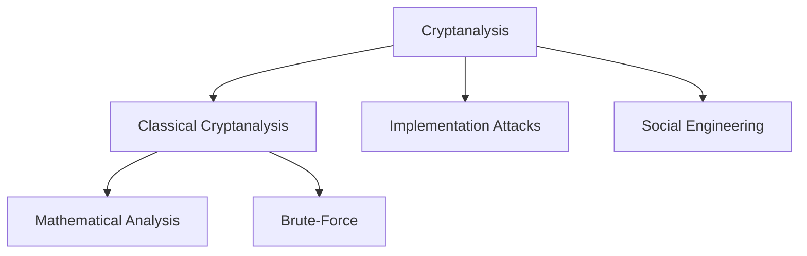

# Chapter 1

- Cryptography -> science of secret writing w/ the goal of hiding the meaning of the message
- Cryptanalysis -> science of breaking cryptosystems
- Symmetric Algorithms -> two parties have encryption and decryption functions in which they both share a secret key
    - All cryptography since until 1976 is based on symmetric algorithms
    - Widely used today for data encryption and integrity checks
- Asymmetric (Public-Key) Algorithms -> a user possesses the secret key as well as the public key
    - Introduced by Whitfield Diffie, Martin Hellman, and Ralph Merkle in 1976
    - Used for digital signatures, key establishment, and data encryption
- Protocols -> the application of cryptographic algorithms
    - Ex: TLS
- Hash functions share properties with symmetric algorithms
- Hybrid Schemes -> the use of multiple different cryptographic algorithms in a system

## Symmetric Cipher
- Known as symmetric cryptographic schemes *aka* symmetric-key *aka* secret-key *aka* single-key schemes/algorithms 
- Problem:
    - Two users Alice & Bob want to communicate over an insecure channel w/o anyone else listening no it
        - Channel -> a communication link
    - Bad guy Oscar is listening (eavesdropping) to the insecure channel
- Solution:
    - Symmetric cipher can be used where:
        - Alice -> x -> Encrypt(x, k) -> y -> Insecure Channel
        - Insecure Channel -> Bob -> y -> Decrypt(y, k) -> x
        - Insecure Channel -> Oscar -> y
        - Oscar only "hears" random characters
        - Both parties (Alice and Bob) needs to know the k (key)
            - In this system, there needs to be a secure channel to distribute the key (textbook will get into it later)
    - x -> plaintext/cleartext
    - y -> ciphertext
    - k -> key
    - Set of all possible keys is known as the key space
- > Both encryption & decryption functions should be publicly known as through peer review can the functions be strong
- > The only thing that should be secret is the key
- **The problem of transmitting a message securely is simply the the problem of transmitting and storing the key securely**

- The Substitution/Replacement Cipher:
    - Idea: substitue each letter of the alphabet with another one
    - Key: substitution table
    1. Attack - Brute-Force / Exhaustive Key Search
        - Testing all possible keys
        - Can result in false-positives
        - Is always possible against symmetric ciphers in principle
        - Is considered computationally secure if it takes too long
        - In this attack, we don't consider the structure of the cipher at all
    2. Attack - Letter Frequency Analysis
        - > The Substitution Cipher can easily be broken by an analytical attack as it maps the statistical properties of the plaintext into the ciphertext
        - Determine the frequency of each character & try to map that into the average frequency and structure
        - Note: a large key space doesn't matter in this attack
    - **Good ciphers hide statistical properties of the ciphertext to where is should appear random; large keyspace != strong encryption**

## Cryptanalysis

- Classical Cryptanalysis -> science of recovering plaintext x or key k from ciphertext y
- Implementation Attacks -> side-channel analysis to obtain the secret key
    - Measuring what happens to where the cryptographic algorithm is *implemented*
    - Most revelant when the attacker has physical access
- Social Engineering Attacks -> tricking humans to obtain the secret key
- (Attacks vary and are plenty)

- Kerckoffs' Principle -> a cryptosystem should be secure even if the attacker knows the algorithm (on a personal level :p) with exception to the key

## Modular Arithmetic
- WIP
